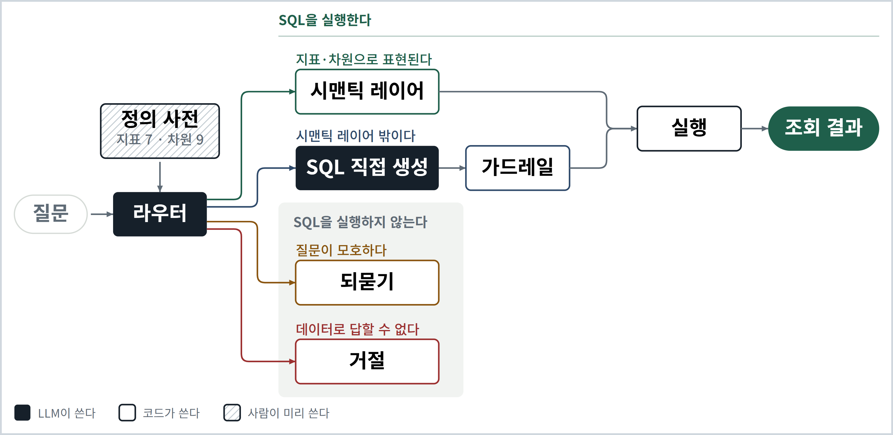

# Natural Language to SQL

SQL 문법과 계산이 맞아도, 사용자가 의도한 질문에 대한 답은 아닐 수 있다.

이 프로젝트는 업무 용어와 집계 기준을 시맨틱 레이어에 정의하고, 질문에 어떤 기준을 적용했는지 사용자에게 보여주는 NL2SQL 참고 구현이다. 모호한 질문에는 확인을 요청하고, 데이터로 답할 수 없는 질문에는 답변 불가를 반환하도록 설계했다.



## 다루는 문제

> 라인별로 규격에 아슬아슬한 건수 알려줘

합격했지만 규격 경계에 가까운 측정을 찾으려는 질문이라고 하자. 이미 규격을 벗어난 측정까지 세었다면, SQL이 정상 실행되고 집계가 정확하더라도 원하는 답은 아니다. 표에 나온 숫자만으로는 이 차이를 알아채기 어렵다.

이 저장소의 비교 실험에서도 같은 질문에 서로 다른 집계 기준이 적용됐다. 직접 생성한 SQL은 전체 측정의 여유 백분위 하위 10%를, 정의된 지표는 합격한 측정의 하위 5%를 집계했다. 백분위는 검사 항목별로 계산한다.

| 생산 라인 | 직접 생성한 SQL | 정의된 지표 |
| --- | ---: | ---: |
| L1 | 37 | 29 |
| L2 | 44 | 20 |
| L3 | 44 | 12 |

포함 대상이 달라지면서 라인별 순위도 바뀐다. 하위 5%는 이 예제에서 정한 업무 기준이다. 그 기준이 질문자의 의도와 맞는지도 확인할 수 있어야 한다.

## 설계

- **업무 정의:** 지표·집계 기준을 카탈로그에 정의하고, 선택한 조건으로 SQL을 생성한다.
- **해석 표시:** 실제 질의의 지표·필터·그룹화·정렬 기준을 결과 앞에 표시한다.
- **추가 확인:** 모호한 질문에는 선택지를 제시하고, 선택한 질의를 검증해 실행한다.
- **답변 불가·실행 차단:** 데이터 부족과 SQL 검사 실패를 별도 상태로 반환한다.

지표 선택이나 추가 확인 여부를 잘못 판단하는 오류는 남아 있다. 모든 조회에 사전 확인을 요구하지는 않는다.

## 비교 평가

계측·규격 검사 합성 데이터에서 SQL 직접 생성 방식과 본 구현을 비교했다. 비교표의 5개 모델에 각각 14문항을 5회씩 실행했으며, 오답 반환과 답변 가능한 질문에 결과를 제공하지 못한 경우를 구분했다.

이 실험은 정해진 정의와 질문에 대한 동작을 확인한다. 실제 사용자가 설명을 읽고 의도 차이를 발견·수정하는 효과는 측정하지 않았다. 모델별 수치, 판정 방식과 제약은 [평가 결과](docs/evaluation.md)에 있다.

## 실행

Python 3.11 이상이 필요하다. 다음 예제는 합성 데이터와 고정된 모델 응답을 사용하므로 API 키 없이 실행할 수 있다.

```bash
git clone https://github.com/utact/nl2sql.git
cd nl2sql
python -m pip install -e '.[dev]'
python -m domain.seed
python -m demo
```

직접 질문하는 웹 화면은 로컬 언어 모델 또는 NVIDIA API에 연결한다. 기본 DB는 SQLite이며 PostgreSQL도 지원한다. 설정과 검사 명령은 [실행 방법](docs/running.md)에 있다.

## 문서

- [구현 구조](docs/implementation.md): 처리 경로, 응답 데이터, SQL 검사와 코드 구성.
- [평가 결과](docs/evaluation.md): 모델별 측정값, 판정 기준과 한계.
- [실행 방법](docs/running.md): 설치, 웹 실행, 모델 설정과 검사.
- [데이터 구조](docs/data.md): 합성 데이터, 뷰와 지표 정의.

## 라이선스

[Apache License 2.0](LICENSE)
