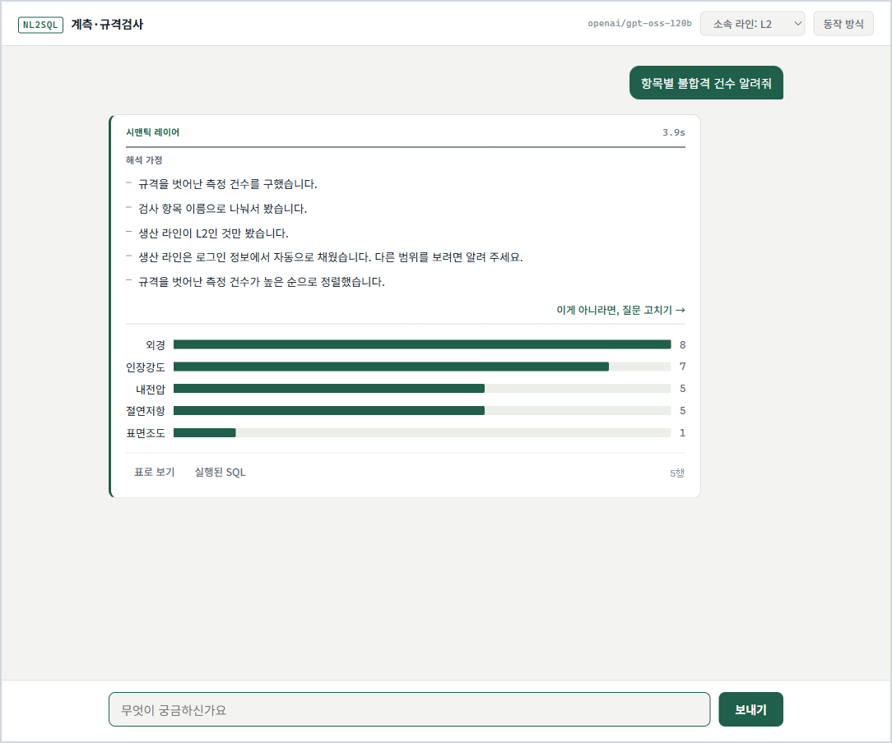

# 구현 구조

## 처리 흐름

[라우터](../nl2sql/router.py)가 질문과 카탈로그를 받아 처리 경로를 선택한다.

| 경로 | 조건 | 처리 |
| --- | --- | --- |
| `semantic` | 정의된 지표·차원으로 표현할 수 있는 질문 | 정의 검증 → SQL 컴파일 → 읽기 전용 실행 |
| `free` | 데이터에는 있지만 정의된 지표로 표현하기 어려운 질문 | LLM의 SQL 생성 → AST 검증·비용 제한 → 읽기 전용 실행 |
| `clarify` | 지표나 조건을 더 확인해야 하는 질문 | 추가 질문과 질의 선택지 반환 |
| `abstain` | 제공된 데이터로 답할 수 없는 질문 | 답변 불가 사유 반환 |

처리 결과는 `ok`, `clarification_needed`, `abstained`, `rejected`, `error`로 구분한다. SQL과 파라미터, 조회 행, 결과 잘림 여부도 응답에 포함한다.

카탈로그는 시작할 때 실제 DB 스키마와 대조한다. 직접 생성한 SQL에는 허용된 뷰·컬럼·함수, 조회 행 수와 예상 비용 검사를 적용한다. 시맨틱 경로는 컴파일러가 정의를 검증하며 직접 생성용 AST·비용 검사를 거치지 않는다. 두 경로 모두 읽기 전용 실행기를 사용한다.

PostgreSQL 구성은 읽기 전용 역할, 실행 시간 제한과 행 수준 보안(RLS)을 포함한다. 접근 권한 검사와 질문 해석의 적절성은 별도로 검증해야 한다. 설정은 [배포 구성](../deploy/compose.yaml)과 [DB 초기화 SQL](../deploy/init.sql)에 있다.

## 응답과 사용자 확인

응답의 `assumptions`에는 적용 기준, `options`에는 추가 확인 선택지, `status`에는 처리 상태를 담는다. 사용자가 고른 질의는 `ask_resolved`가 다시 검증하고 모델을 호출하지 않고 실행한다.

시맨틱 경로의 설명은 선택한 지표·필터·정렬과 카탈로그의 설명문에서 생성한다. 직접 생성 경로는 SQL 구문 트리에서 조회 대상·필터·그룹화·정렬을 추출하며, 모델이 작성한 보충 설명도 함께 표시한다.

지표 설명은 `_headline`이 첫 문장과 괄호 앞부분을 추출해 표시한다. 따라서 정의에 포함된 세부 임계값이 모두 화면 설명에 노출되는 것은 아니다. SQL과 파라미터는 응답에 포함되며 화면에서 확인할 수 있다.

## 코드 구성

| 파일 | 역할 |
| --- | --- |
| [domain/catalog.py](../domain/catalog.py) | 도메인 뷰, 지표·차원, 값 매핑과 조합 제약 |
| [nl2sql/semantic.py](../nl2sql/semantic.py) | 구조화된 질의 검증과 SQL 컴파일 |
| [nl2sql/router.py](../nl2sql/router.py) | 처리 경로와 시맨틱 질의 선택 |
| [nl2sql/pipeline.py](../nl2sql/pipeline.py) | 실행 흐름, 적용 기준 설명, 추가 확인과 응답 상태 |
| [nl2sql/ast_guard.py](../nl2sql/ast_guard.py) | 직접 생성한 SQL의 정적 검사와 구조 추출 |
| [app/server.py](../app/server.py) | 질의 API와 웹 화면 제공 |
| [tests/test_regressions.py](../tests/test_regressions.py) | 기존 오류 사례의 회귀 검사 |

새 도메인을 적용하려면 카탈로그의 정의와 뷰를 구성하고 실제 스키마에 맞는지 검증해야 한다. 화면의 예시 질문과 컨텍스트 설정도 도메인에 맞게 조정해야 한다.

## 제약

정의에 없는 이름이나 허용되지 않은 조합은 검사할 수 있지만, 유효한 지표 중 잘못된 지표를 선택한 경우까지 모두 검출하지는 못한다. 라우터가 추가 확인 대신 조회를 선택하거나, 직접 생성한 SQL이 질문과 다른 내용을 집계할 수 있다.

시맨틱 레이어의 정의와 설명 역시 검토 대상이다. 이 구현은 선택한 기준을 추적하고 수정할 수 있는 구조를 제공하며, 사용자 의도와 결과의 일치를 자동으로 보증하지 않는다.
